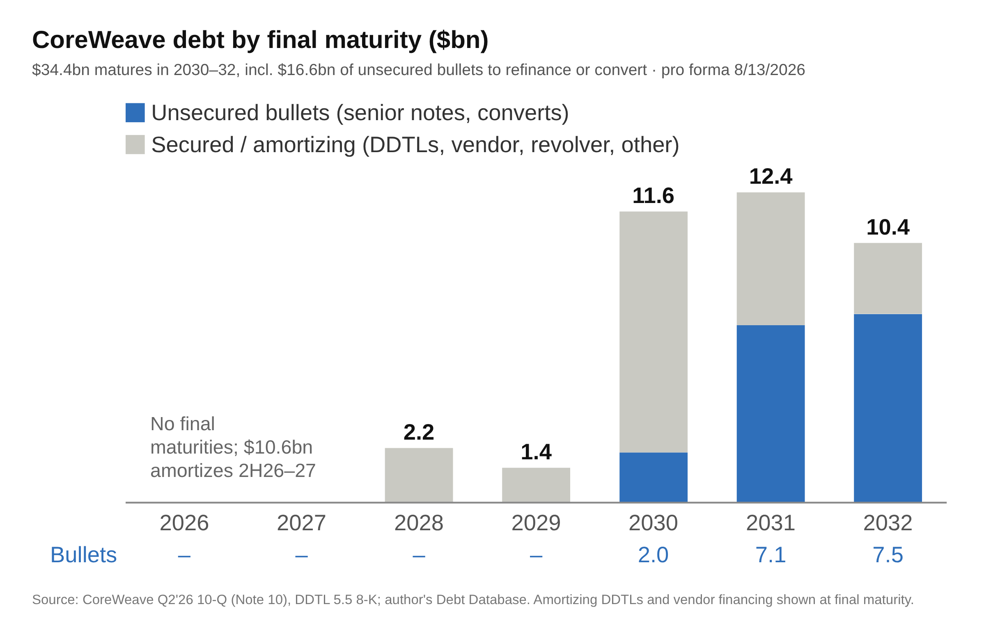

# CoreWeave (CRWV) Credit Review

A credit review of CoreWeave, Inc. built from its SEC filings, **as of August 13, 2026** (the day after the Q2 2026 10-Q). Financials are at June 30, 2026; debt is pro forma for subsequent events known by that date (the DDTL 5.5 facility and the August revolver draw). Later information, such as the September 2026 convertible notes and Q3 results, is deliberately excluded.

**The question:** can a company growing this fast service the debt that funds the growth?

📄 **[2-page credit memo (PDF)](CoreWeave%20Credit%20Memo.pdf)** · 📊 **[Model (Excel)](CoreWeave%20Credit%20Model.xlsx)**

## Key findings

| | |
|---|---|
| Pro forma debt (8/13/2026) | $38.0bn: 90% recourse to the parent, 56% secured, 35% floating; weighted effective rate 8.4% |
| New financing needed, Jul 2026 to Dec 2027 | ~$44.8bn (capex of $57.9bn is nearly 4x operating cash flow) |
| Total debt / Adj. EBITDA | 8.6x LTM, 6.3x on a Q2'26 run-rate |
| Adj. EBITDA / interest | 2.35x LTM |
| Adj. operating income / interest | 0.24x LTM: depreciation absorbs ~90% of Adj. EBITDA |
| Liquidity / next-12-month debt service | 1.66x; 0.81x excluding DDTL capacity that can only fund capex |
| Maturity profile | No final maturities before 2028; $34.4bn in 2030–32, incl. $16.6bn of unsecured bullets |

### Downside scenarios (FY27E)

| | Base | A: GPU pricing | B: delays + pricing + rates |
|---|---|---|---|
| Adj. EBITDA margin | 57.3% | 45% | 45% |
| Revenue vs plan | – | – | −10% 2H26, −20% FY27 |
| SOFR shock / new debt rate | 0bp / 9.5% | 0bp / 11.0% | +100bp / 12.0% |
| New financing, 2H26–FY27 ($mm) | 44,840 | 48,907 | 51,693 |
| Debt / FY27 Adj. EBITDA | 7.5x | 10.1x | 13.0x |
| Adj. EBITDA / interest | 1.87x | 1.31x | **0.96x** |

## The model

Every number traces back to a filing. Tabs, in order of the workflow:

| Tab | What it does |
|---|---|
| Sources | Filing list (10-Q, 10-K, earnings releases, 8-K) with accession numbers and links |
| 10Q_* / 10K_* / PR_* / Subsequent / Guidance | Raw data copied verbatim from the filings (statements, debt note tables and text, non-GAAP reconciliations, subsequent events, company guidance); check rows tie each table |
| Debt Database | One row per instrument: borrower, recourse, security, guarantee, commitment, principal, subsequent draws, undrawn capacity, rate, maturity, amortization; ties to the 10-Q totals |
| Funding Need | Sources and uses for 2H26 and FY27, including interest on facility draws and on new debt (solved in closed form, no circular reference) |
| Metrics | LTM and run-rate leverage, EBITDA and EBIT interest coverage, liquidity vs next-12-month debt service |
| Maturity | Scheduled principal by year (10-Q) and debt by final maturity year, with the maturity-wall chart |
| Scenarios | Switch in C4 (1 = Base, 2 = Downside A, 3 = Downside B) re-runs the whole model; results for all three cases side by side |
| Assumptions Log | 24 assumptions, each linked to the model, with source, rationale, alternatives considered and the impact if wrong |

Colour convention: blue = hard-coded input from a source, green = link to another tab, black = formula.

## Main assumptions

- Capex on the company's definition (PP&E additions including finance leases, less change in construction in progress); FY26 at the guidance midpoint ($37bn), FY27 held flat.
- FY27 revenue held at the exiting-2026 ARR guidance midpoint ($19bn, no growth: conservative); Adj. EBITDA margin at the 1H26 actual (57.3%).
- No credit for customer prepayments or working capital; restricted cash excluded; $2.0bn minimum cash.
- Interest at 10-Q effective rates (DDTL 5.5 assumed at 10%); new debt at 9.5%, drawn evenly, not repaid before 2028.

## Sources

- [Form 10-Q, Q2 2026](https://www.sec.gov/Archives/edgar/data/1769628/000176962826000366/crwv-20260630.htm) and [Form 10-K, FY2025](https://www.sec.gov/Archives/edgar/data/1769628/000176962826000104/0001769628-26-000104-index.htm)
- [Q2 2026](https://www.sec.gov/Archives/edgar/data/1769628/000176962826000362/coreweave2q26earningspress.htm) and [Q4 2025](https://www.sec.gov/Archives/edgar/data/1769628/000176962826000094/coreweave4q25earningspress.htm) earnings press releases
- [Form 8-K, DDTL 5.5 facility (filed 8/10/2026)](https://www.sec.gov/Archives/edgar/data/1769628/000176962826000357/0001769628-26-000357-index.htm)
- [Q3 and FY 2026 Outlook Presentation](https://s205.q4cdn.com/133937190/files/doc_financials/2026/q2/CoreWeave-Q2-26-Earnings-Outlook-Presentation.pdf), [Q2'26 Earnings Presentation](https://s205.q4cdn.com/133937190/files/doc_financials/2026/q2/CoreWeave-Q2-26-Earnings-Presentation.pdf), [Q2 2026 earnings call transcript](https://s205.q4cdn.com/133937190/files/doc_financials/2026/q2/CRWV-US-CORRECTED-TRANSCRIPT-CoreWeave-Q2-2026-Earnings-Call-11August2026.pdf)

---

*Personal project for educational purposes. Adj. EBITDA and Adj. operating income are company-reported non-GAAP measures. Not investment advice.*
